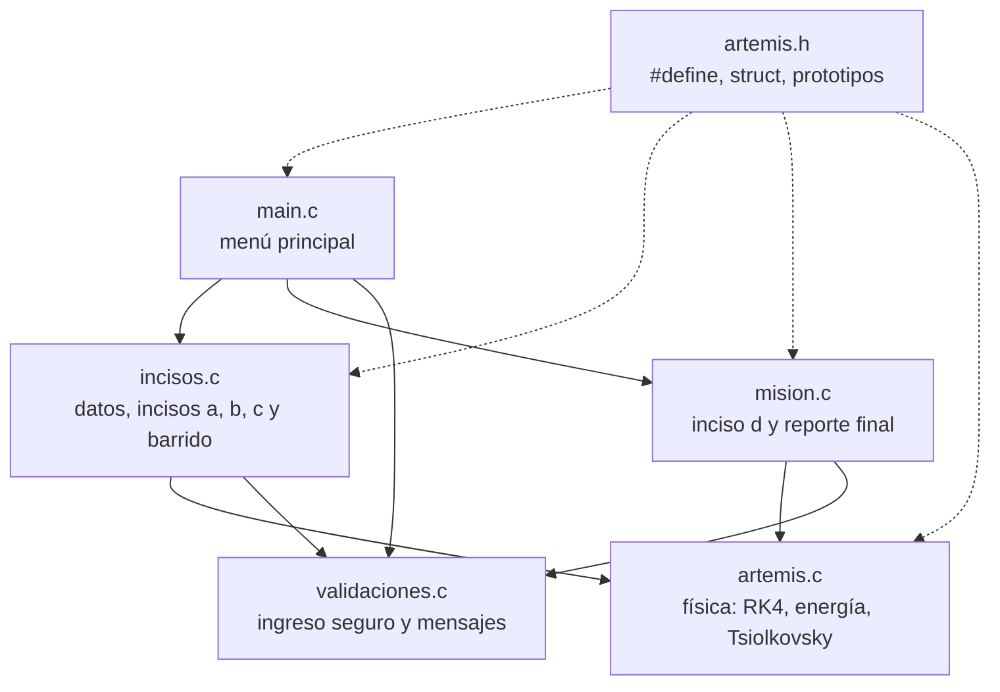

# ¿Llega Orion a la Luna? — Simulador de Inyección Translunar (TLI) en C

Trabajo Práctico Integrador Final — Algoritmos y Estructuras de Datos (UTN FRRe, Ingeniería en Sistemas de Información).
Escenario asignado: **Situación-Problema 3: Inyección Translunar — TLI e inercia en trayectoria libre (1.ª ley de Newton y energía).**

## a) Integrantes y comisión

| Integrante | Módulo a cargo |
|---|---|
| Lopez Tomas | Estructura del repositorio, `artemis.h`, `validaciones.c/.h` y `main.c` |
| Roa Genaro | `artemis.c` (física, Runge-Kutta y memoria dinámica) e inciso a |
| Hernandez Aisar | Datos de la misión e inciso b (`incisos.c`), secciones b, c y e del README |
| Gonzalez Liz | Energía y barrido (`artemis.c`), inciso c y barrido (`incisos.c`), sección d del README |
| Santillan Paula | Tsiolkovsky (`artemis.c`) y `mision.c`: inciso d, bitácora y reporte final |

**Comisión:** _completar_

## b) Escenario y reglas del juego

Orion está en órbita baja (LEO, h = 192 km). La etapa ICPS hace la inyección translunar y deja a la nave a
v_TLI = 10.900 m/s. Después se separa y los motores se apagan: Orion (m = 26.000 kg) sigue por inercia hacia
la Luna (D = 384.000 km). El programa responde los cuatro incisos de la consigna con esos datos o con los que
ingrese el usuario, y cada inciso es un desafío que suma puntos:

| Inciso | Qué hace el programa | Desafío | Puntos |
|---|---|---|---|
| a) 1.ª ley de Newton | Simula con Runge-Kutta 4 la nave con gravedad y la compara con un MRU (sin gravedad). Tabla de r, v y a cada 12 h | Pregunta sobre la inercia | 5 |
| b) Energía cinética | K = ½·m·v² paso a paso y equivalencias (TNT, kWh) | Calcular K en GJ, 3 intentos con diagnóstico del error | 10 / 7 / 4 |
| c) Conservación de la energía | Punto neutro gravitatorio, U(r), Em, W_ext/m, v mínima y perfil del pozo | Predecir si llega antes de calcular | 5 |
| d) Ida vs. vuelta | Ecuación de Tsiolkovsky y justificación energética | Juego de 3 niveles: cargar el combustible justo (ida, vuelta, misión completa) | 35 |
| Barrido | W_ext/m para un rango de velocidades | — | — |

Reglas del juego de combustible (inciso d): en cada encendido hay 3 intentos. Si el Δv no alcanza, se
reintenta con una pista. Si alcanza con hasta un 10 % de sobra se obtienen 10 / 7 / 4 puntos según el intento;
si sobra más, la mitad. El reporte final suma los puntos (máximo 55), asigna un rango y cuenta las entradas
inválidas corregidas. Se puede guardar en `reporte_mision.txt`.

## c) Funcionamiento

### Arquitectura

| Archivo | Responsabilidad |
|---|---|
| `main.c` | Solo `main()`: menú principal y flujo general |
| `artemis.h` | Constantes (`#define`), tipos (`struct`, `typedef`, `enum`) y prototipos públicos |
| `artemis.c` | Física (con vector dinámico de muestras): aceleración neta, potencial, punto neutro, paso RK4, simulación, análisis de energía y de combustible, barrido |
| `incisos.c` | Menú de datos de la misión, incisos a, b, c y barrido (cálculo + interfaz + puntaje) |
| `mision.c` | Juego del inciso d, bitácora (lista enlazada) y reporte final (pantalla o archivo) |
| `validaciones.c/.h` | `leerEntero`, `leerReal`, `leerOpcion`, `leerSiNo`, mensajes de error/aviso |

### Estructuras de datos

- `Parametros`: datos de entrada (v_TLI, masa, h, D, Isp).
- `EstadoNave`: estado (t, r, v) que modifica `pasoRK4` por **puntero**.
- `Muestra *`: **vector dinámico** con la tabla del inciso a. Se reserva con `malloc`, crece con `realloc`
  (duplica la capacidad) y se libera con `free` al terminar el inciso.
- `Bitacora` / `NodoEvento`: **lista simplemente enlazada** con punteros a cabeza y cola. Cada inciso agrega
  un nodo (`malloc`); el reporte la recorre y `liberarBitacora` libera todos los nodos al reiniciar o al salir.
- `ResultadoSimulacion`, `AnalisisEnergia`, `AnalisisCombustible`: resultados que las funciones de cálculo
  devuelven a través de punteros.
- `Reporte`: estado del juego (puntos, intentos, resultados de cada inciso).
- Arreglos paralelos `velocidades[]`, `trabajos[]`, `estados[]` en el barrido.

### Modelo físico

Problema unidimensional sobre la recta Tierra-Luna:

- a(r) = −G·M_T/r² + G·M_L/(D − r)²
- U(r)/m = −G·M_T/r − G·M_L/(D − r)
- Punto neutro: x_eq = D / (1 + √(M_L/M_T))
- W_ext/m = U(x_eq) − [v²/2 + U(r₀)] (positivo: falta energía; negativo: sobra)
- Tsiolkovsky: Δv = Isp·g₀·ln(m₀/m_f)

Constantes de la cátedra: G = 6,674 × 10⁻¹¹, M_T = 5,972 × 10²⁴ kg, R_T = 6.371 km; M_L = 7,342 × 10²² kg.

Simplificaciones (declaradas en el programa): se desprecian la rotación del sistema y el movimiento de la
Luna; el punto neutro **no** es el punto de Lagrange L₁ (≈ 326.000 km); en el inciso d se usa el mismo motor
en ambos encendidos, aunque en la misión real la TLI la hace la ICPS (RL10, Isp ≈ 460 s).

### Resultados con los datos de la consigna

| Magnitud | Valor |
|---|---|
| K inicial | 1,54453 × 10¹² J = 1.544,53 GJ |
| Punto neutro | 345.672 km del centro de la Tierra |
| W_ext/m | +57,15 kJ/kg → con 10.900 m/s **no llega**; necesita v ≥ 10.905,2 m/s |
| Distancia máxima simulada (RK4) | ≈ 314.000 km a las 92 h, y vuelve a caer |
| Δv ida / vuelta | 3.107 m/s / 676 m/s |
| Combustible ida / vuelta (Isp 316 s) | 44.861 kg / 6.342 kg (7,1 veces más para ir) |
| Pozo terrestre / lunar | 60,7 MJ/kg / 2,7 MJ/kg (22,8 veces más profundo) |

## d) Compilación y ejecución

_En construcción._

## e) Registro de uso de Inteligencia Artificial

_En construcción._
